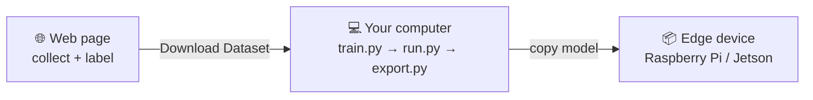

# TESR AI Vision Web Trainer

Train an image-recognition AI **entirely in your browser** — nothing to install,
your photos never leave your computer — then take the *same dataset* to
production-grade YOLO on your PC and deploy it to a Raspberry Pi or NVIDIA Jetson.

**▶ Try it now: https://tesr-channel.github.io/AI_vision_Trainer/**

## What you can build in 10 minutes

- **Object Detection** — draw boxes (straight *or rotated*), the AI finds your
  object and reports its **center position (x, y)** live — the numbers a robot
  arm, conveyor or sorting system needs.
- **Classification** — no boxes at all: the AI names what it sees. The fastest
  path for sorting, go/no-go checks and demos.

Everything runs on WebGL/WebGPU in the page: capture from your webcam, upload
files, auto-augment small datasets, train in seconds, test live, and export.

## Try it

1. Open the page (Chrome/Edge recommended). The UI is **English by default;
   the 🌐 button switches the page to Thai**.
2. Pick a task, add 2+ classes (a "background" class of your empty scene makes
   the "none" answer much more reliable).
3. Hold **Capture** while moving the object around — angle, distance, lighting.
4. Detection: click a photo (or **Label photos**) and drag a box.
   **Scroll / Q / E rotates the box** for tilted objects — it exports as YOLO OBB.
5. **Train**, then **Live Test** with your webcam.
6. **Export** — pick the device (**PC / Raspberry Pi 5 / Jetson Orin / Jetson Nano**)
   and camera (**USB / CSI**), then:
   - **Download for Device (.zip)** — `model.onnx` + `predict.py` (needs only
     `onnxruntime` + OpenCV, no TensorFlow) + the matching installer
     (`install_pi.sh`, `install_jetson.sh` + `build_trt.sh`, …) + `README_DEPLOY.md`.
   - **ONNX only** — one standard `model.onnx` (opset 13, input `images [1,3,224,224]`
     RGB 0..1). Ready for `trtexec --onnx=model.onnx --fp16` (course chapter 8).
   - **Send to ROI Studio** — the model appears directly in
     [TESR ROI Studio](https://tesr-channel.github.io/AI_ROI_Designer/) → *My models*.
   - **Download Dataset (YOLO)** — your photos + labels, ready for real YOLO training below.

   Every zip opens with a short **`START_HERE.md`** (Thai + English): pick your case —
   PC, Pi 5, Jetson, TensorRT, your own code, ROI Studio, train on PC or on the Jetson itself.

### What's inside model.onnx

Built **in the browser** from the exact weights you trained (MobileNetV2 backbone
+ your heads) and verified on the spot: the page runs the file with
onnxruntime-web and compares it with the TF.js model on one of your photos.

| Output | Shape | Meaning |
|---|---|---|
| `output0` (detection) | `[1, 4+nc, 71]` | YOLO-style candidates: cx,cy,w,h in 224-px space + class scores (background classes zeroed, "looks like my photos" gate applied) — any Ultralytics-style decoder (conf filter + NMS) reads it |
| `probs` | `[1, nc]` | whole-frame class probabilities |
| `box` (detection) | `[1, 4]` | one-object box, normalized cx,cy,w,h |
| `feat` | `[1, 1280]` | embedding for the "none" similarity gate |

### Multi-object detection (beta)

Live Test → **Detect multi**: one backbone pass scores 71 regions of the frame
(7×7 feature grid, windows of 7/5/3/2 cells), each region is classified by your
head, its box refined by your box head, then overlaps are merged (NMS). Every
object gets its own box + center. It's coarser than YOLO — use it for demos and
counting; for production multi-object boxes, train the YOLO dataset.

## 🏭 From browser to edge — one path

The in-browser model is great for learning and quick demos, but production wants
YOLO. **Download the dataset and train it offline — same photos, same labels,
one command:**

Train and **export on your computer** (GPU trains in minutes, CPU also works),
then copy the exported model + generated sample code to the device.
`train.py` auto-detects detection / rotated (OBB) / classification from the
dataset itself, and `export.py` writes a `sample_predict.py` you can drop
into any project — plus an MQTT → Node-RED example.

**Full guide: [`yolo-trainer/README.md`](yolo-trainer/README.md)** (English + Thai)

## Honest limits of the in-browser model

The browser trainer uses feature-embedding + a small head — perfect for
learning and prototyping, best at **one object per frame** (multi-object is beta), and accuracy below a fully
trained YOLO. When you outgrow it, you don't start over: download the dataset
and train it offline with YOLO — same photos, same labels, one command.

## 🇹🇭 สรุปภาษาไทย (Thai summary)

เทรน AI ตรวจจับ/จำแนกภาพได้ทั้งหมดในเบราว์เซอร์ โดยไม่ต้องติดตั้งอะไรและรูปไม่ออกจากเครื่อง
(กดปุ่ม 🌐 บนหน้าเว็บเพื่อสลับเป็นภาษาไทย)

1. เลือกโหมด: **Detection** (ลากกรอบ หมุนกรอบตามวัตถุเอียงได้ ได้ตำแหน่ง center
   สำหรับหุ่นยนต์/สายพาน) หรือ **Classification** (ไม่ต้องลากกรอบ เร็วที่สุด)
2. ถ่ายรูป + ติด label บนเว็บ → เทรน → ทดสอบสดผ่าน webcam ได้ทันที
3. จะเอาไปใช้จริง: กด **Download Dataset (YOLO)** แล้วเทรนด้วย YOLO
   **บนคอมพิวเตอร์** (`python train.py` — ตรวจโหมดให้อัตโนมัติ รวมกรอบเอียง OBB)
4. Export บนคอมพิวเตอร์ (`python export.py --target pi`) แล้วก๊อปโมเดล +
   sample code ที่ระบบสร้างให้ ไปรันบน Raspberry Pi / Jetson
5. หรือใช้โมเดลจากเว็บโดยตรง: เลือกอุปกรณ์ (PC / Pi 5 / Jetson) + กล้อง (USB / CSI)
   แล้วกด **Download for Device** ได้ `model.onnx` + `predict.py` + ตัวติดตั้งตรงรุ่น,
   **ONNX only** สำหรับบท ONNX → TensorRT หรือ **Send to ROI Studio** ส่งโมเดลไปวาง ROI ต่อได้ทันที
6. โหมด **Detect multi (beta)** ตรวจจับหลายวัตถุพร้อมกันในเฟรม แต่ละชิ้นได้กรอบ + center

คู่มือฉบับเต็ม (ไทย/อังกฤษ): [`yolo-trainer/README.md`](yolo-trainer/README.md)

## 📚 Learn more with TESR Academy

This trainer is part of TESR's hands-on AI Vision courses — **Build, Train and
Deploy AI to Edge Devices**: Raspberry Pi, NVIDIA Jetson, industrial cameras,
MQTT/Node-RED integration and Smart Factory solutions.

- 🌐 [tesracademy.com](https://tesracademy.com) · 🛒 [tesrshop.com](https://tesrshop.com)
- Facebook / YouTube: **TESR Channel**

## Repository layout

| Path | What |
|---|---|
| `index.html`, `i18n.js` | the web trainer (Thai strings in `i18n.js`) |
| `onnx-export.js` | in-browser TF.js → ONNX writer (backbone + heads + multi-object `output0`) |
| `edge-runtime/` | `predict.py`, installers, `build_trt.sh`, `README_DEPLOY.md` shipped in the device zip |
| `edge-files.js` | generated from `edge-runtime/` — run `python tools/build_edge_files.py` after editing it |
| `yolo-trainer/` | offline YOLO train / run / export |

## License

MIT — use it, teach with it, build on it.
